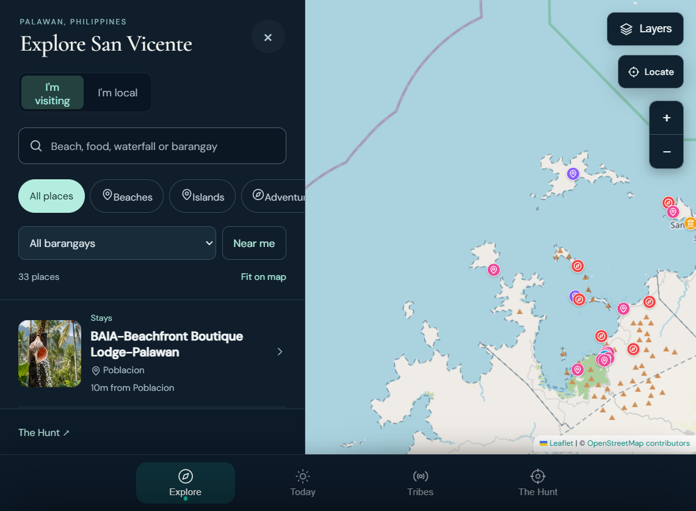

<div align="center">

# SANVIC

### *Explore San Vicente, Palawan*

**An interactive destination guide and community platform for San Vicente, Palawan.**

[](https://www.typescriptlang.org/)
[](https://react.dev/)
[](https://vite.dev/)
[](https://supabase.com/)
[](https://tailwindcss.com/)

</div>

---

## The Product

**SANVIC** is a destination discovery and community platform built for San Vicente,
Palawan — a coastal municipality whose beaches, islands and small businesses are
spread across a coastline most visitors never navigate well.

The app is built around four connected surfaces, reachable from a persistent
bottom navigation bar:

| Surface | What it does |
| --- | --- |
| **Explore** | A layered, interactive map of the municipality. Switch between Street, Dark, Satellite and Terrain basemaps, toggle barangay boundaries, and search beaches, food, waterfalls and barangays. Every place is a marker; every marker opens a full detail sheet. |
| **Today** | A daily briefing — live local conditions, sunset times, what's happening, and **Tala**, a San Vicente concierge assistant with voice output that answers questions about destinations, timing, routes and hidden gems. |
| **Tribes** | *Pulse.* Small groups, live plans and local happenings. Travellers join existing tribes or start their own, with live participation counts and category filters. |
| **The Hunt** | A discovery game. Find hidden spots, unlock stories, collect badges and earn rewards across San Vicente, with progress tracking and discoverable nearby finds. |

Place detail sheets carry the full editorial record: photography, video,
barangay, access and season information, ratings, coordinates, and tappable
booking links.

---

## Screenshots



*Explore — the layered map of San Vicente with category filters, barangay
selection and 33 mapped places.*

<details>
<summary><strong>More screenshots</strong></summary>

| | |
| --- | --- |
| **Tribes** — Pulse, live groups and happenings | **The Hunt** — daily hunt and nearby discoveries |
|  |  |
| **Place detail** — media, editorial, booking | **Today** — Tala, the San Vicente concierge |
|  |  |

</details>

---

## Tech Stack

### Languages

| Language | Where it's used | Share of the codebase |
| --- | --- | --- |
| **TypeScript / TSX** | Application shell, components, hooks, Supabase integration | 63 files |
| **JavaScript** | The SANVIC client in `public/site/` — map engine, views, personalization | 9 modules |
| **CSS** | Design system in `src/styles.css` and `explore-ux.css` | Tailwind + custom |
| **SQL** | PostgreSQL schema, RLS policies, functions and seed data | 11 migrations |
| **HTML** | `public/site/index.html` — the application document | 1 |

### Frontend

- **React 19** + **TypeScript** — application shell
- **TanStack Start** + **TanStack Router** — file-based routing, SSR, build target
- **TanStack Query** — server state
- **Vite 8** — dev server and build pipeline
- **Tailwind CSS 4** — design tokens and utility styling
- **Radix UI** + **shadcn/ui** — 50 accessible primitives
- **Recharts** — data visualisation
- **Leaflet** — mapping engine
- **Lucide** — iconography
- **Sonner** — toasts

### Mapping & Geodata

- **Leaflet** with **OpenStreetMap** street and dark tiles
- **Esri** satellite imagery, **OpenTopMap** terrain
- **Philippine Statistics Authority (PSA)** barangay boundaries, December 2023
- **OpenStreetMap contributors** — attribution displayed in-app

### Backend

- **Supabase** — managed PostgreSQL, Auth, Storage and Realtime
- **PostgreSQL 17** with **Row Level Security** on every public table
- **PostgREST** via `@supabase/supabase-js`
- **Storage buckets** for destination images and video

### Tooling

- **npm** / Node 24
- **Nitro** build output (Cloudflare-compatible)
- **ESLint** + **Prettier**
- **Vitest**-style test harness in `tests/`

---

## Code Tree

```
golden-goose-eggs/
├── public/
│   └── site/                        # The SANVIC client
│       ├── index.html               # Application document (all views)
│       ├── app.js                   # Map engine, routing, view logic
│       ├── entry-flow.js            # Onboarding and entry flow
│       ├── entry-polish.js          # Entry refinements
│       ├── explore-model.js         # Explore state model
│       ├── explore-ux.css           # Explore-specific styling
│       ├── barangay-marker-polish.js# Marker rendering
│       ├── map-pin-boost.js         # Marker performance
│       ├── personalize.js           # Localisation and preferences
│       ├── pulse-demo-content.js    # Tribes / Pulse content
│       ├── barangays.geojson.js     # PSA barangay geometry
│       ├── supabase-config.js       # Public Supabase connection
│       └── assets/                  # Photography, logos, Pulse imagery
│
├── src/                             # Application shell
│   ├── routes/
│   │   ├── __root.tsx               # Document shell, SEO, error boundary
│   │   ├── index.tsx                # Entry → mounts the SANVIC client
│   │   └── api/
│   │       └── tala-chat.ts         # Tala concierge endpoint
│   ├── components/
│   │   └── ui/                      # 50 Radix / shadcn primitives
│   ├── integrations/
│   │   └── supabase/
│   │       ├── client.ts            # Browser client
│   │       ├── client.server.ts     # Server client
│   │       ├── auth-middleware.ts   # Session middleware
│   │       ├── auth-attacher.ts     # Auth context attachment
│   │       └── types.ts             # Generated database types
│   ├── hooks/
│   │   └── use-mobile.tsx
│   ├── lib/
│   │   ├── buildVersion.ts          # Deploy cache-busting stamp
│   │   ├── error-capture.ts
│   │   ├── error-page.ts
│   │   └── utils.ts
│   ├── styles.css                   # Design system
│   ├── server.ts                    # SSR entry
│   └── router.tsx
│
├── supabase/
│   ├── migrations/                  # 11 historical SQL migrations
│   ├── config.toml
│   └── seed_images.sql
│
├── tests/
│   └── explore-model.test.cjs
│
├── docs/
│   └── explore-ux-v2-review.md
│
├── .env.example                     # Public Supabase config (safe to commit)
├── AGENTS.md                        # Working notes for this codebase
└── package.json
```

---

## Getting Started

### Prerequisites

- Node.js 20 or newer (developed on 24)
- A Supabase project

### Setup

```bash
git clone https://github.com/digitalnativepalawan/golden-goose-eggs-work.git
cd golden-goose-eggs-work
npm install
cp .env.example .env
npm run dev
```

The dev server prints its local URL. The React shell mounts the SANVIC client
from `public/site/`.

### Scripts

| Command | Purpose |
| --- | --- |
| `npm run dev` | Development server |
| `npm run build` | Production build |
| `npm run preview` | Preview the production build |
| `npm run lint` | ESLint |
| `npm run format` | Prettier |

### Configuration

Configuration lives in `.env`, which is git-ignored. `.env.example` is committed
and contains only public values — project ID, URL and publishable key. These are
embedded in the client bundle by design and are safe to publish; all access is
governed by Row Level Security policies in the database.

> **Never commit a secret key or the database password.**

---

## Database

- **PostgreSQL 17** on Supabase, region `ap-southeast-2`
- **22 tables** across `public` — destinations, nearby places, Pulse posts,
  comments, likes, tribes, events, notifications, the Hunt, Tala and settings
- **50 Row Level Security policies**; RLS enabled on 19 tables
- **8 functions** for roles, moderation and travel profiles

### Working with the database

`supabase/migrations/` is a **historical record**, not a replayable migration
path. The authoritative source for the current schema is the PostgreSQL dump.
Applying the migration files to a fresh project is not supported.

### Backoffice

The task-oriented **SANVIC Studio** opens from the site's Staff admin control,
or directly at `/site/index.html?admin=1`. It uses Supabase Auth and RLS for
places, map pins, photos, categories and the existing content editors. The
separate `/admin` route remains available for raw table/media tooling.

Before using Draft, Published and Archived states, apply
`supabase/migrations/20261026120000_destination_publishing.sql` in the Supabase
SQL Editor and verify it with
`supabase/scripts/03_verify_admin_publishing.sql`. See
`docs/admin-backoffice-audit.md` for the full audit and workflow notes.

---

## Project Status

Working toward a public launch.

**Complete**

- Data migrated to a new Supabase project, verified row by row
- Security pass: rotated credentials, revoked tokens, RLS intact
- Lovable scaffolding and branding removed — no third-party attribution remains
- Repo moved out of cloud-sync directories; secrets and backups excluded from git

**In progress**

- Interface and content work
- Permanent hosting (currently a temporary tunnel for review)

**Known gaps**

- Some destination images and videos still need re-uploading to Storage — a
  database dump restores the rows that reference media, never the media itself
- Auth provider configuration (magic link, Google) and redirect URLs are pending

---

## Roadmap

- Direct booking integration with local operators
- Owner portal for business verification and profile management
- Offline support and installable PWA
- Expanded tribe and hunt mechanics
- Multilingual support

---

## About

Built by **[Palawan Collective](https://github.com/digitalnativepalawan)** and
**[MerQato.digital](https://merqato.digital)**.

### Palawan Collective + MerQato.digital
**DESIGN · DEVELOPMENT · AUTOMATION**

Palawan Collective and MerQato.digital work together to connect local businesses,
tourism, and regional opportunities with thoughtful design and practical
technology. Rooted in Palawan, Philippines, we build digital experiences,
websites, software platforms, and intelligent systems that help businesses grow,
operate more efficiently, and reach new markets.

Our work spans web design and development, interactive maps, destination
discovery, tourism and hospitality platforms, direct booking systems, business
dashboards, AI agents, workflow automation, and custom digital solutions. We
combine local knowledge with modern technologies to create tools that solve real
problems, simplify operations, improve customer experiences, and unlock new
revenue opportunities.

Through Palawan Collective, we develop digital initiatives that showcase
Palawan's destinations, connect travelers with local businesses, strengthen
tourism and hospitality, and create opportunities for the communities and
entrepreneurs who make the region unique. Through MerQato.digital, we design and
develop the underlying technology — from high-performance websites and custom
applications to AI-powered workflows, integrations, and scalable digital
infrastructure.

We believe technology should be practical, accessible, and built around the
people who use it. Every project is an opportunity to combine thoughtful design,
reliable development, and intelligent automation into solutions that deliver
lasting value.

Our approach is entrepreneurial, hands-on, and focused on execution. We explore
open-source technologies, build reusable tools, integrate modern platforms, and
develop systems that can evolve alongside the businesses and communities they
serve.

**Our focus:** Web development, digital product design, software engineering, AI
agents, business automation, interactive mapping, tourism technology, hospitality
systems, direct bookings, digital marketing, and scalable business solutions.

**Our mission:** To build meaningful digital infrastructure for local businesses
and emerging destinations, starting in Palawan and creating solutions with the
potential to reach far beyond it.

> *Local businesses. Distinct digital worlds. Rooted in Palawan. Built for what's next.*

---

## Acknowledgements

- Map data © [OpenStreetMap](https://www.openstreetmap.org/copyright) contributors
- Satellite imagery © Esri, Vantor, Earthstar Geographics and the GIS User Community
- Barangay boundaries: Philippine Statistics Authority, December 2023, via
  [faeldon/philippines-json-maps](https://github.com/faeldon/philippines-json-maps) (MIT)
- Icons: [Lucide](https://lucide.dev) — ISC, with the Feather-derived icons
  under MIT. The icon shapes are inlined into `public/site/app.js`; the full
  notices are in [`THIRD-PARTY-NOTICES.md`](THIRD-PARTY-NOTICES.md)

---

## License

Proprietary — © Palawan Collective. All rights reserved.

Photography and imagery are licensed separately; credits are recorded in
`public/photo-credits.json`.