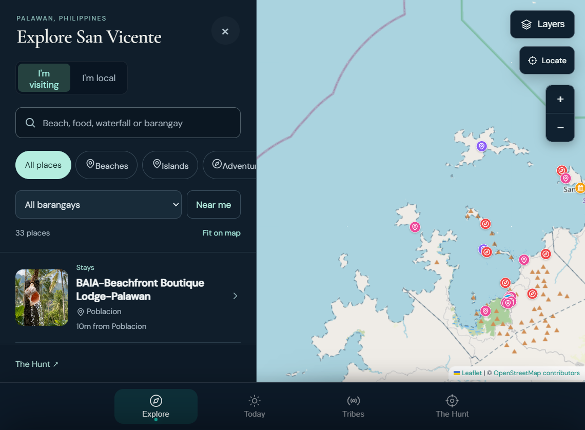

<div align="center">

# SANVIC

### _Explore San Vicente, Palawan_

**An interactive destination guide and community platform for San Vicente, Palawan.**

[](https://developer.mozilla.org/docs/Web/JavaScript)
[](https://leafletjs.com/)
[](https://supabase.com/)
[](https://vercel.com/)
[](docs/tech-stack-and-code-tree.md)

</div>

---

## The Product

**SANVIC** is a destination discovery and community platform built for San Vicente,
Palawan — a coastal municipality whose beaches, islands and small businesses are
spread across a coastline most visitors never navigate well.

The app is built around four connected surfaces, reachable from a persistent
bottom navigation bar:

| Surface      | What it does                                                                                                                                                                                                                                                  |
| ------------ | ------------------------------------------------------------------------------------------------------------------------------------------------------------------------------------------------------------------------------------------------------------- |
| **Explore**  | A layered, interactive map of the municipality. Switch between Street, Dark, Satellite and Terrain basemaps, toggle barangay boundaries, and search beaches, food, waterfalls and barangays. Every place is a marker; every marker opens a full detail sheet. |
| **Today**    | A daily briefing — live local conditions, sunset times, what's happening, and **Tala**, a San Vicente concierge assistant with voice output that answers questions about destinations, timing, routes and hidden gems.                                        |
| **Tribes**   | _Pulse._ Small groups, live plans and local happenings. Travellers join existing tribes or start their own, with live participation counts and category filters.                                                                                              |
| **The Hunt** | A discovery game. Find hidden spots, unlock stories, collect badges and earn rewards across San Vicente, with progress tracking and discoverable nearby finds.                                                                                                |

Place detail sheets carry the full editorial record: photography, video,
barangay, access and season information, ratings, coordinates, and tappable
booking links.

---

## Screenshots



_Explore — the layered map of San Vicente with category filters, barangay
selection and live place markers._

_More captures (Tribes, The Hunt, place detail, Today) belong in
[`docs/screenshots/`](docs/screenshots/README.md). That folder currently holds
only its own README, so the table below lists what still needs capturing rather
than pointing at files that do not exist._

| View                                           | File                          | Status  |
| ---------------------------------------------- | ----------------------------- | ------- |
| **Tribes** — Pulse, live groups and happenings | `docs/screenshots/tribes.png` | pending |
| **The Hunt** — daily hunt and nearby finds     | `docs/screenshots/hunt.png`   | pending |
| **Place detail** — media, editorial, booking   | `docs/screenshots/place.png`  | pending |
| **Today** — Tala, the San Vicente concierge    | `docs/screenshots/today.png`  | pending |

---

## Tech Stack

The shipped product is deliberately **buildless**: static HTML, CSS and JS served
exactly as written, with Leaflet and Supabase loaded from CDNs. The React /
TanStack app in `src/` is a development shell — `vercel.json` does not build it.

### Languages

| Language             | Where it's used                                                      | Size                                    |
| -------------------- | -------------------------------------------------------------------- | --------------------------------------- |
| **JavaScript**       | `public/site/` — map, Explore, Pulse, Today, Backoffice, KMZ         | 16 files; 22,657 lines incl. HTML + CSS |
| **HTML**             | `public/site/index.html` — every screen's markup + the design system | 1 file, 2,497 lines                     |
| **CSS**              | inline `<style>` in `index.html`, `explore-ux.css`, `admin-ux.css`   | 2,972 lines in the two stylesheets      |
| **TypeScript / TSX** | React dev shell, Tala server, KMZ parser                             | 31 files                                |
| **SQL**              | schema, RLS policies, functions, seed data                           | 32 historical migrations                |

### Front end (the product)

- **Vanilla JavaScript**, one shared global scope, strict load order — no
  bundler, no framework, no TypeScript
- **Leaflet 1.9.4** — map engine, CDN
- **@supabase/supabase-js v2** — UMD bundle, CDN
- **Google Fonts** — Cormorant Garamond + DM Sans
- Hand-rolled glassmorphic design system: CSS custom properties in
  `index.html`, with Explore and Backoffice stylesheets layered on top

### Dev shell (`src/`, not deployed)

- **React 19** + **TypeScript 5.8**
- **TanStack Start 1.168** + **TanStack Router** — file-based routes, SSR
- **TanStack Query**, **Vite 8**, **Tailwind CSS 4**
- **Radix UI / shadcn** — 9 primitives in `src/components/ui/` (imported by
  nothing today; kept as scaffolding)
- **Lucide** icons in the shell; the product inlines its own Lucide SVGs
- **Nitro** build target (Cloudflare-compatible), available but unused by
  `vercel.json`

### Mapping & geodata

- **Leaflet** with **OpenStreetMap** street and dark tiles
- **Esri** satellite imagery, **OpenTopoMap** terrain
- **Philippine Statistics Authority** barangay boundaries, December 2023
- **OpenStreetMap contributors** — attribution displayed in-app

### Backend

- **Supabase** — managed PostgreSQL 17, Auth, Storage, Realtime
- **Row Level Security** on every public table; 31 tables queried by the client
- **PostgREST** via `@supabase/supabase-js`
- **Storage buckets** — `destination-images`, `destination-videos`, `media`,
  `traveler-experiences`, `pulse-media`
- **Tala AI proxy** — `api/tala.js` (Vercel Function) → `server/tala.js` →
  OpenRouter; the key lives only in `OPENROUTER_API_KEY`

### Tooling & deploy

- **npm**, Node 20+ (verified on 22.22.3)
- **ESLint 9** + **Prettier 3**
- **`node --test`** — 10 test files, 72 assertions, no framework
- **Vercel** — static `public/site` + one function; no framework, no build step

---

## Code Tree

```
golden-goose-eggs-work/
├── public/site/                     # THE PRODUCT — static, 22,657 lines, no build
│   ├── index.html      2,497 ln     # every screen's markup + the design system CSS
│   ├── app-core.js       252 ln     # data, samples policy, live-data state
│   ├── app-map-explore-today.js 2,943 ln  # identity, taxonomy + icons, map, Today, Explore
│   ├── app-pulse.js    2,644 ln     # Pulse: feed, tribes, events, Lounge
│   ├── app-weather.js  1,374 ln     # hero weather widget, then boot on `load`
│   ├── app-backoffice.js 1,413 ln   # the in-app Backoffice panel
│   ├── app-place-details.js 2,595 ln # place sheet: gallery, video, tips, contacts
│   ├── app-pulse-admin-my-sanvic-hunt.js 1,390 ln # moderation, My Sanvic, the Hunt
│   ├── admin-studio.js 2,979 ln     # Backoffice UI (overrides openAdminPanel)
│   ├── admin-model.js    447 ln     # Backoffice rules (pure, unit-tested)
│   ├── explore-model.js  258 ln     # Explore filtering/sorting (pure, unit-tested)
│   ├── kmz-import.js     426 ln     # KMZ/KML upload + preview
│   ├── entry-flow.js     235 ln     # first-visit questions — currently OFF
│   ├── personalize.js    129 ln     # locale, units, preferences
│   ├── pulse-demo-content.js 73 ln  # Pulse seed content
│   ├── supabase-config.js 26 ln     # `sb` client + loads three experience modules
│   ├── barangays.geojson.js         # PSA barangay geometry (32 KB)
│   ├── explore-ux.css  1,146 ln     # Explore sheet + map controls
│   ├── admin-ux.css    1,826 ln     # Backoffice layout
│   └── assets/                      # logo, 4 hero photos, 6 Pulse photos
│
├── src/                             # React shell — dev only under vercel.json
│   ├── routes/
│   │   ├── __root.tsx               # document shell, SEO, error boundary
│   │   ├── index.tsx                # / → /site/index.html?v=…
│   │   └── api/tala-chat.ts         # Tala endpoint for `npm run dev`
│   ├── components/ui/               # 9 Radix / shadcn primitives (unimported)
│   ├── integrations/supabase/       # browser client, auth, types.ts
│   ├── hooks/use-mobile.tsx
│   ├── lib/                         # kmz-parser, buildVersion, error pages, utils
│   ├── router.tsx · start.ts · server.ts · styles.css · routeTree.gen.ts
│   └── (26 .ts/.tsx files)
│
├── server/tala.js           352 ln  # OpenRouter proxy: prompt, knowledge, rate limit
├── api/tala.js               18 ln  # Vercel Function served at /api/tala-chat
│
├── supabase/
│   ├── migrations/                  # 32 files — historical, not replayable
│   ├── scripts/                     # health check, make_admin, 2 verifications
│   ├── config.toml
│   └── seed_images.sql
│
├── tests/                           # 10 test files + support/client.cjs
│   ├── admin-model · admin-ui · content-policy · dom-contract
│   ├── explore-model · explore-search · feed · map-tools
│   ├── kmz-import.test.mjs · tala-server.test.mjs
│   └── support/client.cjs           # rebuilds the client from the loader lists
│
├── docs/
│   ├── tech-stack-and-code-tree.md  # stack, boot order, flow, current state
│   ├── admin-backoffice-audit.md    # October audit (historical)
│   ├── explore-ux-v2-review.md      # Explore v2 review (historical)
│   ├── images/explore-map.png
│   └── screenshots/                 # README captures, see its README
│
├── vercel.json                      # static public/site + /api rewrite + cache
├── vite.config.ts                   # React shell only
├── package.json · tsconfig.json · eslint.config.js · .prettierrc
├── .env.example                     # public Supabase values only
├── components.json                  # shadcn config
└── README.md · AGENTS.md · HANDOFF.md · THIRD-PARTY-NOTICES.md
```

Full detail — boot order, data flow, and the current-state notes — is in
[`docs/tech-stack-and-code-tree.md`](docs/tech-stack-and-code-tree.md).

---

## Getting Started

### Prerequisites

- Node.js 20 or newer (verified on 22.22.3)
- A Supabase project — `.env.example` already points at the live one

### Setup

```bash
git clone https://github.com/digitalnativepalawan/golden-goose-eggs-work.git
cd golden-goose-eggs-work
npm ci
cp .env.example .env
npm run dev
```

The dev server prints its URL (Vite picks **8080**, or the next free port). `/`
renders the React shell, which redirects into `public/site/index.html`; the
static client can also be opened directly at `/site/index.html`.

`.env` is only needed for the React shell and the Tala proxy. The product itself
carries its public Supabase URL and publishable key in
`public/site/supabase-config.js`, so a static deploy needs no environment
variables.

### Scripts

| Command           | Purpose                                       |
| ----------------- | --------------------------------------------- |
| `npm run dev`     | Vite dev server (React shell + static client) |
| `npm run build`   | Nitro production build → `.output/`           |
| `npm run preview` | Preview that build                            |
| `npm test`        | `node --test tests/*.test.*`                  |
| `npm run lint`    | ESLint                                        |
| `npm run format`  | Prettier                                      |

### Configuration

Two layers:

- **Product** — `public/site/supabase-config.js` holds the project URL and the
  publishable key. Both are public by design; every table is governed by Row
  Level Security.
- **Shell & server** — `.env` (git-ignored, copied from `.env.example`) feeds the
  React shell and the Tala function: `SUPABASE_*`, `VITE_SUPABASE_*` and the
  optional `OPENROUTER_API_KEY` for live AI. Secrets stay server-side and are
  never given a `VITE_` prefix.

> **Never commit a secret key or the database password.**

---

## Database

- **PostgreSQL 17** on Supabase, region `ap-southeast-2`
- **31 tables queried by the client** — destinations, place details, nearby places,
  Pulse posts/comments/likes, tribes, tribe members and messages, events and event
  interest/messages, the Hunt, Today, saved places, site and Tala settings
- **87 Row Level Security policies** in `supabase/migrations/`; RLS enabled on 18 tables
- **11 functions** for roles, moderation, tribe guards and travel profiles

Counted from the files on disk on 2026-11-09: 32 migration files,
22 `CREATE TABLE`, 87 `CREATE POLICY`, 18 `ENABLE ROW LEVEL SECURITY`.
Tables that predate the migration history are not in those counts but are
queried by the client.

### Working with the database

`supabase/migrations/` is a **historical record**, not a replayable migration
path. The authoritative source for the current schema is the PostgreSQL dump.
Applying the migration files to a fresh project is not supported.

### Backoffice

The task-oriented **SANVIC Studio** opens by tapping the SANVIC.PH logo in the
header three times, or directly at `/site/index.html?admin=1`. There is no Admin
button in the dock — staff access is deliberately unlabelled. The **Hunt** tab
edits the riddles (verse, answer coordinates, hint, photo, show/hide); on the
site the riddle photo is shown whole and tapping it opens the full picture with
the verse. There is **no login and no PIN** for content edits:
it writes with the publishable key, and RLS plus
`supabase/migrations/20261101090000_open_backoffice_writes.sql` permit that.
Photo uploads need no sign-in either: the media gallery posts to the
`destination-images` bucket with the publishable key, which
`20261101090000_open_backoffice_writes.sql` opened. Photos straight from a phone
work too — HEIC/HEIF is converted to JPEG in the browser before upload.

The old passcode `/admin` page (React route plus service-role `/api/admin`) was
removed on 2026-11-09. It was a second, redundant admin surface; the in-app
Backoffice above is the only one now. Nothing in production depended on it.

Before using Draft, Published and Archived states, apply
`supabase/migrations/20261026120000_destination_publishing.sql` in the Supabase
SQL Editor and verify it with
`supabase/scripts/03_verify_admin_publishing.sql`. See
`docs/admin-backoffice-audit.md` for the historical audit and
`docs/tech-stack-and-code-tree.md` for the current map of the code.

---

## Project Status

Working toward a public launch.

**Complete**

- Data migrated to a new Supabase project, verified row by row
- Security pass: rotated credentials, revoked tokens, RLS intact
- Lovable scaffolding and branding removed — no third-party attribution remains
- Repo moved out of cloud-sync directories; secrets and backups excluded from git

**In progress**

- Interface and content work
- First-visit onboarding is built but switched off (`ENTRY_QUESTIONS_ON`
  in `public/site/entry-flow.js`) — turn it on before launch

**Hosting**

- **Vercel**, static: `vercel.json` serves `public/site/` verbatim and runs one
  function at `api/tala.js`. There is no build step and no tunnel in the
  deployment path. The React shell in `src/` runs locally only.

**Verified 2026-11-09**

- `npm ci`, `npm run lint` (0 errors, 2 warnings), `npx tsc --noEmit`,
  `npm test` (72 assertions: 68 pass, 4 skipped) and `npm run build` all pass

**Known gaps**

- Some destination images and videos still need re-uploading to Storage — a
  database dump restores the rows that reference media, never the media itself
- Photo uploads in the Backoffice need an authenticated admin account; content
  edits do not
- Auth provider configuration (magic link, Google) and redirect URLs are pending
- Screenshots for Tribes, The Hunt, Place detail and Today still need capturing

---

## Roadmap

- Direct booking integration with local operators
- Owner portal for business verification and profile management
- Offline support and installable PWA
- Expanded tribe and hunt mechanics
- Multilingual support

---

## About

Built by **[Palawan Collective](https://github.com/digitalnativepalawan)** and
**[MerQato.digital](https://merqato.digital)**.

### Palawan Collective + MerQato.digital

**DESIGN · DEVELOPMENT · AUTOMATION**

Palawan Collective and MerQato.digital work together to connect local businesses,
tourism, and regional opportunities with thoughtful design and practical
technology. Rooted in Palawan, Philippines, we build digital experiences,
websites, software platforms, and intelligent systems that help businesses grow,
operate more efficiently, and reach new markets.

Our work spans web design and development, interactive maps, destination
discovery, tourism and hospitality platforms, direct booking systems, business
dashboards, AI agents, workflow automation, and custom digital solutions. We
combine local knowledge with modern technologies to create tools that solve real
problems, simplify operations, improve customer experiences, and unlock new
revenue opportunities.

Through Palawan Collective, we develop digital initiatives that showcase
Palawan's destinations, connect travelers with local businesses, strengthen
tourism and hospitality, and create opportunities for the communities and
entrepreneurs who make the region unique. Through MerQato.digital, we design and
develop the underlying technology — from high-performance websites and custom
applications to AI-powered workflows, integrations, and scalable digital
infrastructure.

We believe technology should be practical, accessible, and built around the
people who use it. Every project is an opportunity to combine thoughtful design,
reliable development, and intelligent automation into solutions that deliver
lasting value.

Our approach is entrepreneurial, hands-on, and focused on execution. We explore
open-source technologies, build reusable tools, integrate modern platforms, and
develop systems that can evolve alongside the businesses and communities they
serve.

**Our focus:** Web development, digital product design, software engineering, AI
agents, business automation, interactive mapping, tourism technology, hospitality
systems, direct bookings, digital marketing, and scalable business solutions.

**Our mission:** To build meaningful digital infrastructure for local businesses
and emerging destinations, starting in Palawan and creating solutions with the
potential to reach far beyond it.

> _Local businesses. Distinct digital worlds. Rooted in Palawan. Built for what's next._

---

## Acknowledgements

- Map data © [OpenStreetMap](https://www.openstreetmap.org/copyright) contributors
- Satellite imagery © Esri, Vantor, Earthstar Geographics and the GIS User Community
- Barangay boundaries: Philippine Statistics Authority, December 2023, via
  [faeldon/philippines-json-maps](https://github.com/faeldon/philippines-json-maps) (MIT)
- Icons: [Lucide](https://lucide.dev) — ISC, with the Feather-derived icons
  under MIT. The icon shapes are inlined into
  `public/site/app-map-explore-today.js`; the full
  notices are in [`THIRD-PARTY-NOTICES.md`](THIRD-PARTY-NOTICES.md)

---

## License

Proprietary — © Palawan Collective. All rights reserved.

Photography and imagery are licensed separately; per-image credits are stored
on the content rows (`destinations.image_credit`, plus the tribe and event credit
columns) and are editable in the Backoffice.
